# BBook — Quyết định kiến trúc PayOS và giới hạn chính sách

Ngày kiểm tra: 28/10/2026. Chỉ triển khai local. Không có xác nhận của Google; chưa đủ điều kiện thu tiền hoặc phát hành.

## A. Current System Audit

| Thành phần | Bằng chứng local | Kết luận |
|---|---|---|
| Backend | HEAD `9847562`, nhánh nền `feature/shareprofile`; có thay đổi Phase 1 chưa commit | Không đồng nhất HEAD với code deploy trên Render |
| Mobile | HEAD `168265b`, Expo `~57.0.24`, RN `0.86.3`, Android `com.bbook.app`, Gradle versionCode 1 | Chưa xác minh binary Play; không cài IAP hoặc sửa mobile trong đợt này |
| Web | HEAD `51685ee`, HTML/JS tĩnh, `scripts/build.mjs` đóng gói danh sách cố định | Chưa có website commerce authentication/session hoặc trang lịch sử mua |
| Phase 1 | Accounts/cohort, VisibilityGrants, reader, GET `/api/mua/me/monetization`, optional eligibility projection | `Enabled=false` mặc định; shadow không chặn publication/booking, không cấp quyền |
| PayOS booking | `IPayOsService`, `PayOsService`, `PayOsSignature`, `BookingService`, POST `/api/Booking/payos/webhook` | Create/get đang kiểm tra BookingPayments và PlayReviewPolicy; không thể tái dùng nguyên service cho monetization |
| Reconcile booking | `BookingService` đọc signed payment-link response, so khớp code/link | Giữ nguyên. Chia sẻ primitive ký/xác minh; không chuyển đơn commerce vào BookingPayments |
| Hoàn tiền | `PayOsRefundPayoutProvider` dùng Payout API và bảng Refunds của booking | Đây là chuyển tiền hoàn có theo dõi, không chứng minh có API đảo giao dịch checkout cho commerce |
| Email | `IEmailSender.SendOtpAsync` / `BrevoEmailSender`, đã có OTP HTML và kiểm tra actor | Có nhà cung cấp Brevo sẵn; không sửa OTP để gửi email bán hàng |
| Tỷ lệ tiền booking | `BookingFinancialCalculator.DepositRate=0.30m`, `PlatformFeeRate=0.08m` | Source hiện là cọc 30%, phí nền tảng 8%; khác mô tả “cọc 8%”. Giữ nguyên, cần đối chiếu production |

Đã rà các đường external navigation/payment/notification bằng tìm kiếm source, chưa audit đầy đủ mọi đường dẫn gián tiếp. Mobile hiện có mở checkout cọc dịch vụ vật lý và social/map/help links. Store listing, cấu hình remote, PayOS channel/webhook đang hoạt động, DB schema production và commit Render chưa được truy cập/xác minh. Không kết luận đã tuân thủ chỉ từ source hoặc test.

## B. Google Play Policy Assessment

### Các căn cứ chính thức đã đọc

1. [Payments policy](https://support.google.com/googleplay/android-developer/answer/9858738), §2, §3(a), §4, §8–9. Trích ngắn: “including account creation or sign-up flows”. Quyền số trong app thuộc §2; dịch vụ vật lý thuộc §3(a); §4 bao gồm dẫn hướng trong listing và quá trình đăng ký. §8–9 yêu cầu thị trường/chương trình đủ điều kiện.
2. [Understanding Payments policy](https://support.google.com/googleplay/android-developer/answer/10281818), FAQ “Can I communicate…”, “Can I offer a consumption-only…”. Trích ngắn: “whether digital or physical”. FAQ cho phép email ngoài app, một số thông tin mua không có link, và consumption-only; định nghĩa sau cùng không cho mua cả dịch vụ vật lý trong app. Administrative/help page không được trở thành cầu nối tới thanh toán bị cấm.
3. [User choice billing](https://support.google.com/googleplay/android-developer/answer/13821247?hl=en-en), phần regional programs; [Billing choice availability](https://support.google.com/googleplay/android-developer/answer/17161464?hl=en), bảng user markets. Không có Việt Nam trong các danh sách được công bố tại lần kiểm tra này. Billing choice còn yêu cầu lựa chọn Play Billing và tích hợp API/chương trình.
4. [External offers](https://support.google.com/googleplay/android-developer/answer/14372887?hl=en), Eligibility/Requirements: chương trình được mô tả cho người dùng EEA. Không lấy việc BBook có website làm bằng chứng đủ điều kiện tại Việt Nam.
5. [Enforcement Process](https://support.google.com/googleplay/android-developer/answer/9899234), phần mở đầu/Enforcement Actions: Google xem cả metadata, trải nghiệm app và SDK; có rejection/removal/suspension. Test nội bộ không thay thế review.

### Áp dụng vào BBook — nhận định kiến trúc, chưa phải phán quyết của Google

| Khoản thu / luồng | Đánh giá đề xuất |
|---|---|
| Khách trả cọc makeup trực tiếp | Phù hợp nhóm dịch vụ thực tế §3(a); giữ hạ tầng hiện tại |
| Activation 100K | Mua quyền xuất bản và nhận booking trên nền tảng; có dấu hiệu quyền số §2. Việc booking cuối cùng là makeup không tự chứng minh ngoại lệ. Xin Google phân loại |
| Quà 30 ngày kèm activation | Có lợi ích quảng bá trong app trong cùng gói. Không được gọi miễn phí để suy ra khoản 100K chỉ là dịch vụ vật lý |
| Visibility 75K/30 ngày | Mua phân phối/hiển thị trong app, xử lý như quyền số. Mua lại chủ động, không recurring subscription |
| App có cọc vật lý + quyền số mua ngoài | FAQ consumption-only nêu giới hạn cả digital/physical: chưa có căn cứ trực tiếp cho mô hình kết hợp BBook. Đây là blocker chính, không bỏ qua |

Ba nhóm quyết định:

- **Có căn cứ rõ:** cọc dịch vụ thực tế qua PayOS; marketing ngoài app đúng phạm vi; quyền mua ngoài được sử dụng trong app consumption-only đúng định nghĩa; thông tin mua không link được FAQ cho phép trong phạm vi đó.
- **Còn phụ thuộc:** activation cụ thể, mô hình app kết hợp, thông báo sau duyệt, wording chưa kích hoạt, website/help links có thể tới commerce. Giữ disabled đến khi xác nhận phạm vi.
- **Không triển khai theo dữ kiện Việt Nam hiện có:** checkout số PayOS trong app, QR/WebView, nút đăng ký đi tới mua, push/deep link thanh toán, che tính năng với reviewer. Đổi Gmail hay tên nút không giải quyết bản chất luồng.

### Website, trạng thái và email

Mẫu trạng thái để review: “Hồ sơ đã được duyệt. Trạng thái kích hoạt: chưa có hiệu lực.” Chỉ dùng trong flow đầy đủ đã công bố điều kiện, không khiến người dùng tưởng duyệt đồng nghĩa xuất bản ngay. Không thêm CTA/email thanh toán vào Android lúc này. FAQ cho phép một số wording mua trên website không link; lựa chọn tạm chưa dùng là do BBook chưa xác nhận mô hình kết hợp, không phải chính sách cấm mọi thông tin website.

Email chứa lời mời mua mới không tự trở thành biên nhận giao dịch chỉ vì admin vừa duyệt. Email sau duyệt là bước bắt buộc để kích hoạt có quan hệ chặt với onboarding app; tài liệu không giải quyết riêng trường hợp này. Phải gửi mô tả/ảnh/trigger thật để hỏi Google. Gmail chỉ là ứng dụng đọc email; nó không quyết định việc nguồn luồng có dẫn hướng hay không. Email tiếp thị độc lập cần opt-in riêng, không là điều kiện mở khóa xuất bản và không dùng CTA trong app để kích hoạt gửi link. Email biên nhận chỉ dựa trên đơn đã được xác minh server-side.

## C. So sánh năm phương án

Các mức chi phí dưới đây là ước lượng tương đối của BBook, không phải báo giá nhà cung cấp.

| Tiêu chí | A: PayOS trong app | B: Đăng ký app → web mua | C: Email ngay sau duyệt | D: Website độc lập + dùng quyền trong app | E: Marketing email độc lập |
|---|---|---|---|---|---|
| Cơ sở chính sách | Chưa có ngoại lệ phù hợp cho quyền số VN | Liên quan §4 signup steering | FAQ email + rủi ro signup nối tiếp | FAQ consumption-only, cần xác nhận mixed app | FAQ ngoài app + consent |
| Điểm chưa chắc | Phân loại activation | Đổi tên nút không thay bản chất | Trigger có là bước thanh toán bắt buộc? | Cọc vật lý trong cùng app có phù hợp? | Có thực sự độc lập onboarding? |
| Trải nghiệm MUA | Ít bước | Chuyển app/browser | Phải mở email, dễ thất lạc | Tự vào web, đăng nhập một lần | Phát hiện gói từ email tự nguyện |
| Tự động hóa | Cao | Cao | Cao nhưng không bật | Cao sau khi có web auth và webhook | Cao, cần consent/suppression |
| Chi phí triển khai | Trung bình | Trung bình | Thấp–trung bình | Trung bình–cao | Trung bình |
| Chi phí vận hành | Support thanh toán + policy cao | Support + policy cao | Email delivery + policy cao | Session, đối soát, support | Deliverability, opt-out, campaign |
| Bảo mật | Cần server verify như mọi phương án | Thêm session/redirect | Link bị forward/hết hạn; phải xác thực owner | Web session, CSRF, owner, verified webhook | Consent + owner; không dùng email làm bearer grant |
| Tái dùng PayOS | Primitive/protocol | Primitive/protocol | Primitive/protocol + email | Hosted checkout + primitive/protocol | Hosted checkout + primitive/protocol |
| Ảnh hưởng app phát hành | Cao | Cao | Cao nếu là flow bắt buộc | Thấp về code; policy mixed app còn blocker | Thấp nếu độc lập; không làm trigger ẩn |
| Trước mở bán | Google xác nhận ngoại lệ/program | Google xác nhận đúng flow | Google xác nhận trigger cụ thể | Google xác nhận mixed model hoặc đổi kiến trúc | Consent, unsubscribe, policy scope, core commerce sẵn sàng |

**Khuyến nghị chính:** D ở trạng thái chưa mở bán, E là kênh tùy chọn sau này; không coi E là phương án tránh chính sách thay cho D.

**Dự phòng không Billing:** tách một ứng dụng MUA consumption-only riêng, không mua dịch vụ trong đó; khách giữ app booking vật lý. Website có onboarding/mua độc lập. Đây là thay đổi sản phẩm lớn, cũng cần xác nhận với Google, không tự tạo app mới trong đợt này. Nếu Google không chấp nhận mixed model và không muốn tách app, phải cân nhắc Play Billing cho quyền số hoặc giữ miễn phí trên Play. Không có bằng chứng một phương án giữ toàn bộ yêu cầu hiện tại chắc chắn được duyệt.

## D. Kiến trúc mục tiêu và phạm vi foundation

### Luồng mục tiêu sau khi gỡ blocker

```mermaid
flowchart LR
    W[Website truy cập độc lập] --> A[Web session và kiểm tra MUA]
    A --> O[Order + payment attempt]
    O --> P[PayOS hosted checkout]
    P --> I[Verified webhook / đối soát]
    I --> T[Inbox + order + outbox + audit]
    T --> F[Worker cấp quyền nguyên tử]
    F --> R[API trạng thái theo JWT]
    R --> M[Android sử dụng quyền]
```

Đây là sơ đồ mục tiêu. Bản local mới có phần lưu đơn/xác minh giả lập/hold outbox; các kết nối live và worker cấp quyền trong sơ đồ chưa được bật hoặc triển khai.

1. Người dùng tự truy cập `https://bbookmakeup.com`, đăng nhập BBook qua web session an toàn; không đi từ CTA mua trong Android.
2. Web lấy catalog và eligibility từ server. Giá 100000/75000 VND, điều khoản phiên bản cụ thể; activation chỉ sau Approved, legacy không trả lại. Visibility chỉ cần activation hợp lệ và điều kiện hoạt động, không ảnh hưởng ordinary booking khi hết hạn.
3. Server lấy MuaId từ principal, tạo order + attempt đã reserve orderCode trong transaction, nhận Idempotency-Key. Không nhận amount/user/provider/returnUrl từ browser. Timeout tạo link giữ cùng code để tra cứu, không lập đơn mới tùy tiện.
4. Adapter tạo PayOS hosted link bằng server credentials. Dùng channel monetization tách booking hoặc router chung được kiểm chứng; không sửa webhook booking hiện có. Không phát checkout URL sang Android.
5. Webhook xác minh signature trên raw signed `data`; so amount/VND/code/link/channel/reference với order đã lưu. Return/cancel URL chỉ hiển thị và đọc lại server. 2xx sau durable commit; lỗi transient không đánh dấu hoàn tất.
6. Inbox khử lặp, order verified + outbox + audit commit cùng transaction. Đối soát GET signed PAID bù webhook mất. Không lưu raw bank payload hoặc secret trong log.
7. Worker tương lai lock theo MUA, đọc lại approval/suspension/deletion/eligibility, cấp activation/gift/publication nguyên tử nếu đủ; paid Visibility nối tiếp cuối interval không bị revoke, chính xác 30×24 giờ. Source unique + gift unique, không cấp lại khi webhook lặp. Chưa đủ điều kiện giữ ManualReview, không tự chi trả hoàn hoặc hủy booking.
8. App chỉ gọi API trạng thái bằng JWT; enforcement phải kiểm tra mọi public query/create-booking endpoint, không chỉ ẩn nút. Giữ quyền booking cũ, rút tiền, cohort waiver.

### Foundation local được triển khai trong đợt này

- Catalog cố định ở backend; 5 bảng additive Orders/Attempts/Inbox/Outbox/Audit, FK owner và unique keys; migration có writer guards và immutable audit/receipt/reference.
- Dịch vụ nội bộ create/idempotency, kiểm tra owner/review/cohort, reserve code, bind signed create response, verify webhook, signed-status reconciliation và history theo owner.
- Thuần protocol ký request PayOS; không có HTTP client cho commerce. Test giả lập response ký HMAC với khóa giả. Không gọi production API.
- Kết quả verified chỉ tới `PaidAwaitingFulfillment` hoặc `ManualReview`, outbox `VerifiedPaymentHold`. Không có worker tiêu thụ hold, không cấp quyền, không xuất bản. Reader/eligibility Phase 1 không đổi.
- Bốn rollout flags mặc định false, chỉ được reserve cho phase sau. Bật chúng cũng không tạo endpoint/trigger/worker trong bản này. Commerce service không đăng ký DI trong Program.
- Web `commerce/contract.mjs` là contract draft qua authenticated transport được inject; không có transport thật/session/trang checkout, không import vào landing, không đóng gói `dist`.
- Email receipt template preview có escape HTML, tên/giá/quyền lợi/hỗ trợ; không sender/approval hook/link mua. Không có email được gửi.

Phần không triển khai vì chưa đủ điều kiện mở bán: live transport, webhook route/channels, web login/session + CSRF, fulfillment/ranking worker, cohort enforcement, public query gating, refund/payout commerce, email delivery/consent/callback. Đây là blocker rõ ràng, không được bật checkout khi thiếu chúng.

### PayOS và hoàn tiền

[API chính thức](https://payos.vn/docs/api/) có create/get/cancel payment link, signed data và mã order; [webhook](https://payos.vn/docs/du-lieu-tra-ve/webhook/) mô tả dữ liệu chuyển tiền và xác nhận bằng 2xx. Adapter mới không dùng BookingPayment để xác minh commerce.

[Tài liệu môi trường test](https://payos.vn/docs/moi-truong-test/) nói không có sandbox riêng. Do cấm thu tiền thật, test chỉ dùng local fixtures/mocks. Chưa kiểm thử ngân hàng/PayOS end-to-end.

Không suy ra cancel link = hoàn tiền đã nhận. Không thấy API refund checkout trong tài liệu payment link đã đọc; cần PayOS xác nhận khả năng kênh và quyền Payout thực tế. Quy trình mục tiêu: yêu cầu hoàn → kiểm tra số đã thu/đã hoàn → duyệt → payout/bank transfer có idempotency → đối soát → audit. Chốt chính sách activation/gift/Visibility đã sử dụng trước khi tự thu hồi. Không chạm booking hiện có.

### Email cho ngân sách sinh viên

| Phương án | Đánh giá cho BBook | Nguồn |
|---|---|---|
| SMTP xác thực từ domain BBook | Có thể dùng; cần queue/retry/bounce và hạn mức nhà cung cấp. Không ưu tiên Gmail cá nhân làm hạ tầng vận hành | Cần lựa chọn hợp đồng SMTP cụ thể trước khi so giá |
| Brevo | Khuyến nghị trước: source đã dùng cho OTP, giảm số nhà cung cấp; Free công bố 300 lượt gửi/ngày; dành quota riêng cho OTP | [Brevo plans](https://help.brevo.com/hc/en-us/articles/208589409-About-Brevo-s-pricing-plans) |
| Resend | Dự phòng: Free công bố 3000/tháng, 100/ngày; API tiện nhưng thêm tích hợp | [Resend pricing](https://resend.com/pricing) |
| Amazon SES | Phù hợp khi lớn hơn; cần domain verification, production access/quota/bounce handling; giá theo plan/region hiện hành | [SES pricing](https://aws.amazon.com/ses/pricing/) |

Giá/hạn mức kiểm tra ngày 28/10/2026; xác nhận lại trên tài khoản trước chọn gói. Domain sender BBook phải xác thực SPF/DKIM và DMARC; không tự thay DNS trong đợt này. Transactional order receipt tách marketing. Delivery không đồng nghĩa provider đã nhận: cần message ID, delivery/bounce/complaint webhook đã xác thực, dedup (order, template, version), retry/backoff, suppression. ApprovalEmail giữ false; không chuyển receipt thành lời mời thanh toán.

[Nghị định 91/2020/NĐ-CP](https://congbao.cdnchinhphu.vn/CongBaoCP/VanBan/2020/8/31908/32282-1-2020837-83891-2020-nd-cp.pdf), Điều 11, 13, 17–20: email quảng cáo cần đồng ý trước, thông tin người quảng cáo, nhãn [QC]/[AD], chức năng từ chối; áp dụng hạn mức theo văn bản. Thiết kế nội bộ mặc định tối đa một campaign/ngày và suppression ngay khi từ chối, không dùng silence hoặc đồng ý điều khoản app làm opt-in marketing.

[Bộ Công an về Luật 91/2025/QH15](https://www.bocongan.gov.vn/bai-viet/bao-ve-du-lieu-ca-nhan-trong-mot-so-hoat-dong-1754989261) nêu yêu cầu đồng ý khi xử lý dữ liệu cho quảng cáo, biết rõ nội dung/phương thức/tần suất và cách từ chối. [Luật có hiệu lực 01/01/2026](https://bocongan.gov.vn/chinh-sach-phap-luat/bai-viet/luat-bao-ve-du-lieu-ca-nhan-chinh-thuc-co-hieu-luc-thi-hanh-tu-ngay-01-01-2026-1767186124). Cần ghi bằng chứng consent/version/source/time, rút consent, retention tối thiểu, DPA và đánh giá chuyển dữ liệu tới nhà cung cấp ngoài Việt Nam theo quy định hiện hành. Không kết luận chỉ thêm nút unsubscribe là đủ tuân thủ pháp luật.

### Guardrails và rollout

- Không thêm Android checkout/QR/link/WebView/notification cho hai quyền số; không dùng approval email làm bước mua ngầm.
- Không sửa listing/help/social page để gián tiếp đi tới mua; phải audit cả redirect và trang đích. Không remote-enable riêng reviewer/user.
- Các API dự kiến dùng principal server, role, account status, rate limits và CSRF cho cookie sessions. Origin/User-Agent/header client không phải bằng chứng nguồn website độc lập.
- Legacy snapshot/backfill và toàn bộ gates phải diễn tập trước enforcement. Chưa có flags nào trong foundation thay quyền hiện hành.
- Mọi thay đổi auto-deploy branch đều là deployment vì Program tự chạy migrations. Không push/merge, chạy migration production hoặc sửa PayOS dashboard.

## E. Câu hỏi Google và review trước phát hành

Bản gửi bằng tiếng Anh: [GOOGLE-PLAY-POLICY-SUPPORT-DRAFT.md](GOOGLE-PLAY-POLICY-SUPPORT-DRAFT.md). Chưa gửi. Cần đính kèm screenshots/flow diagram thật, package/versionCode và đầy đủ việc app vẫn có PayOS booking vật lý; không bỏ chi tiết gây bất lợi.

Thứ tự gỡ blocker: xác nhận mixed app + signup/email → chốt architecture/sản phẩm → website auth → provider channel/ingress + retry/deletion retention → fulfillment/cohort/gating → privacy/email/refund terms → staging regression → hỗ trợ/đối soát → review Play → pilot có phê duyệt riêng.

Checklist triển khai và kết quả test local: [MUA-COMMERCE-LOCAL-VERIFICATION.md](MUA-COMMERCE-LOCAL-VERIFICATION.md).

Kết quả kiểm chứng: backend build đạt; 223/223 ca hồi quy chọn lọc và 20/20 ca web đạt, không bỏ qua. Migration/đồng thời được kiểm tra trên PostgreSQL disposable local; không chạy thanh toán thật. EF không có pending model changes. Kết quả này không xác nhận Google Play approval hay production readiness.
